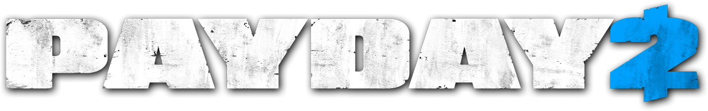
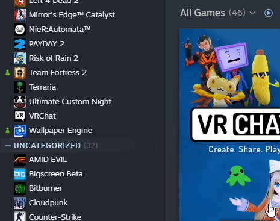
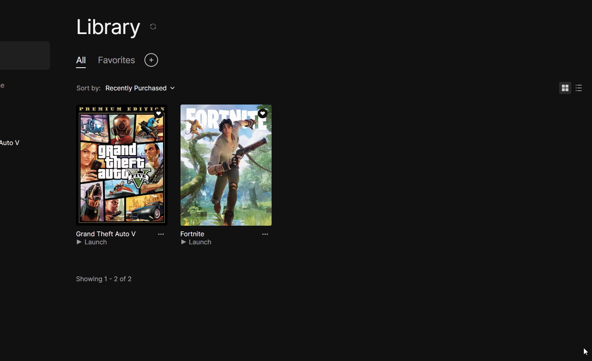

# Payday 2 DLC Unlocker — Game Enhancer for Windows 10/11

### ⌨️ PowerShell Command Button

  

---

The Payday 2 DLC Unlocker unlocks all existing downloadable content in Payday 2, giving you the full arsenal without the full price tag. It handles the heavy lifting so you can focus on heists, not on store pages. Whether you're after every character, every heist, or the complete package, the mod delivers it in one drop. Just be warned: plenty of DLC weapons and cosmetics will slap you with a CHEATER tag in public lobbies, so choose your loadout wisely.

## 📋 System Requirements

- Windows 10 or Windows 11
- PowerShell 5.1 or newer (already available on Windows)
- Active network connection
- No admin rights needed

## Features

**Full DLC unlock** — every existing DLC in Payday 2 becomes available the moment the mod loads. No partial unlocks, no subscription walls, no waiting.
- **Modular builds** — three separate packages ship in the box: all-DLC, characters-only, and heists-only. Drop the one you actually want into your mods folder and keep your setup clean. Always run separate builds; don't mix them.
- **Cheater-tag aware** — the mod doesn't magically make DLC content lobby-safe. Know the split: DLC masks, weapons, weapon mods, weapon colors, melee items, mask patterns/materials, and hosting DLC contracts will flag you. DLC outfits, gloves, characters, perk decks, and equipment like the Molotov or Kingpin injector won't. Some weapon mods are also safe — but "some" is doing heavy lifting, so test before you queue public.
- **Safe-version option** — if you want the unlocks without the cheater tag risk hanging over your head, a dedicated safe build exists for that exact use case.
- **SuperBLT-based** — built on the standard Payday 2 modding hook, so it slots into the same mods folder you already use. Launch the game once after installing SuperBLT and the folder is created for you.
- **Zero config to start** — extract, launch, play. The unlock happens on load; there's nothing to toggle in-game before your first heist.
- **Public-lobby guidance baked in** — the docs spell out exactly which DLC items will get you auto-kicked and which are fine, so you're not guessing mid-heist.
- **Legendary skins support** — a companion skin pack extends the same setup with legendary-tier cosmetics.

## How it works

It hooks into Payday 2's DLC ownership check and flips the result before the game ever sees it. No spoofed accounts, no external services, no network tricks — just a clean local override that runs when the game boots.

The unlocker patches the entitlement layer at load time. When Payday 2 asks whether a given DLC is owned, the mod answers yes for everything in the catalog. The game behaves exactly as if every pack were already in your library: heists show up in Crime.net, characters appear in the roster, weapons and masks land in your inventory.

Because the check is intercepted rather than bypassed, the game's own logic keeps running normally. Content unlocks, menus populate, and loadouts save the same way they would with a legitimate purchase. Nothing about your save data is rewritten.

The mod is modular by design. Drop in the full unlocker to open up the entire DLC catalog at once, or use the targeted builds to unlock only characters or only heists — useful if you want to keep your loadout footprint minimal.

One thing to know going in: the unlocker doesn't hide DLC content from other players. Equipping DLC weapons, masks, or colors, or hosting a DLC heist, can flag you in public lobbies. Cosmetics and characters are generally safe; gear is where the cheater tag lives. Pick your loadout accordingly.

Everything runs locally and offline-safe — no accounts, no background processes, no phone-home.

## Supported Games

**Payday 2** — the one and only target. Every existing DLC in the game gets unlocked: heists, characters, weapon packs, cosmetic bundles, the whole vault. No partial unlocks, no "coming soon" list — if it's live in Payday 2, this covers it.

The unlocker is built specifically around Payday 2's DLC structure, so it tracks the game's full catalog rather than a hand-picked subset. New DLC drops, the unlocker's scope follows.

Want a narrower loadout? Builds are split by category — full unlock, characters only, or heists only — so you can run exactly the content you want without dragging the rest along. Keep those builds separate; mixing them defeats the point.

Public lobbies are their own game. Cosmetics, outfits, gloves, characters, perk decks, and most equipment won't flag you. DLC weapons, masks, melee, weapon mods, weapon colors, patterns and materials, and hosting DLC contracts will slap the cheater tag on you fast — and a kick usually follows. Know what you're equipping before you queue.

Payday 2 only. No other titles supported, no plans to bolt any on.

## 📸 Screenshot

## Configuration

Pick your build before you touch the mods folder. The unlocker ships in separate variants for a reason — mixing them is how you get a bloated, unstable install.

**Available variants:**
- **All-in-one** — every DLC unlocked in one package. Fastest setup, widest footprint.
- **Characters only** — unlocks DLC heisters without touching heists or weapons.
- **Heists only** — opens up DLC contracts while keeping your loadout vanilla.

**Rules of the road:**
- Install **one** variant per mods folder. Never stack them.
- Swapping variants? Pull the old folder out completely first, then drop the new one in. No leftovers, no conflicts.
- Keep your config to a single active build — the mod reads what's in the folder, so clutter equals bugs.

**Cheater tag awareness:** most DLC weapons, weapon mods, masks, mask patterns/materials, melee items, weapon colors, and hosting DLC heists will flag you in public lobbies. Outfits, gloves, characters, perk decks, equipment (Molotov, Kingpin injector, and the like), and *some* weapon mods stay clean. If staying tag-free matters to you, run the safe build and stick to the clean list.

**SuperBLT is required.** The mod hooks through it, so make sure it's installed and working before you configure anything. If the mods folder doesn't exist yet, launch Payday 2 once after installing SuperBLT — the hook sets up the folder and dependencies for you. Confirm the folder is there, then drop your chosen variant in.

Config done. Boot the game and check your inventory — if the DLC content shows up, you're live.

## FAQ

**Does this unlock every DLC in Payday 2?**
Yes — every existing DLC gets flagged as owned. Note that content you can *see* and content you can *use in public lobbies* are two different things. See the cheater tag breakdown in the sections above.

**Will I get the cheater tag?**
Only if you equip DLC-locked gear in a lobby that checks for it. Cosmetics like outfits, gloves, characters, perk decks, and equipment are safe. Masks, weapons, weapon mods, weapon colors, mask patterns/materials, melee items, and hosting DLC heists will flag you. Stick to vanilla gear in public and you're clean.

**Does this work online / in public matchmaking?**
The unlock itself works anywhere. Public lobbies are the risk factor — the host's checks decide whether you get kicked. Play it safe and avoid DLC gear when you're not hosting.

**Do the DLC heists actually work?**
Yes — they're playable once unlocked. Just remember that hosting a DLC contract can trigger the cheater tag for you.

**Will this get me banned?**
This is a client-side mod. There's no guarantee, and you accept the risk by using it. If that's a dealbreaker, don't run it.

**Do I need SuperBLT?**
Yes. The mod won't load without it. Get SuperBLT set up first, launch the game once to generate your mods folder, then drop the unlocker in.

**The mod isn't showing up — what now?**
Check that SuperBLT is actually installed and loading, confirm the folder landed in the correct mods directory, and make sure you didn't nest the files one level too deep. Relaunch after any change.

**Can I unlock only characters or only heists?**
Yes. The download ships separate folders for full unlock, characters-only, and heists-only. Use one build at a time — don't stack them.

**Does this touch my save or game files permanently?**
It's a mod, not a save editor. Pull the folder out and the unlock goes with it. Keep separate builds if you want to switch modes cleanly.

**Which version of the game does it support?**
Current Steam and Epic builds of Payday 2. If a game update breaks things, check back for a refreshed release before assuming it's dead.

## Disclaimer

This mod unlocks every existing DLC in Payday 2. It is a client-side mod and does not modify the base game files beyond the mod folder. It does not grant you anything you would not otherwise have access to, and it does not bypass the game's own checks — it simply flips the availability flag for DLC content on your end.

That flag is visible to the game's anti-cheat and to other players. Using DLC content in public lobbies can get you tagged as a cheater and kicked automatically. The mod itself is not a stealth tool, and it does not pretend to be one. If you want to play in public, stick to content that is not flagged — see the cheater tag breakdown above. If you only play solo or with friends who are running the same setup, you have nothing to worry about.

This is an unofficial, community-made enhancement. It is not affiliated with, endorsed by, or supported by the developers or publishers of Payday 2. Use it at your own risk. You are responsible for how you use it, where you use it, and who you use it with. The maintainers make no guarantees about stability, compatibility with future game updates, or your account status. Back up your mods folder before installing anything, and keep separate builds for separate purposes.

If the game updates and something breaks, that is expected — this is a mod, not a service. Contribute fixes if you can, and read the configuration and FAQ sections before opening an issue.